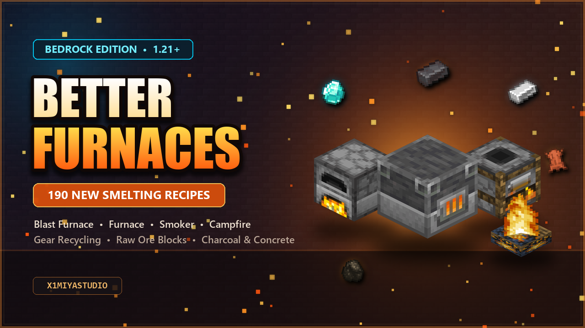

# Better Furnaces — Bedrock Edition

  
  

[-22C55E?style=for-the-badge)](https://github.com/X1miyaStudio/Better-Furnaces-Bedrock/releases)

**Comprehensive smelting overhaul for all vanilla heat blocks in Minecraft Bedrock Edition.**  
Adds **190 logical smelting recipes** across the **Blast Furnace**, **Furnace**, **Smoker**, **Campfire**, and **Soul Campfire** — no experimental toggles required.

---

## ⚙️ Features (190 Recipes)

### 🔥 1. Blast Furnace Speedups (2× Faster)
The Blast Furnace now handles high-temperature building & utility recipes in addition to ores:
- **Stone & Deepslate:** Cobblestone ➔ Stone ➔ Smooth Stone, Stone Bricks ➔ Cracked Stone Bricks, Cobbled Deepslate ➔ Deepslate, Deepslate Bricks/Tiles ➔ Cracked variants.
- **Nether & Blackstone:** Netherrack ➔ Nether Brick, Nether Bricks & Polished Blackstone Bricks ➔ Cracked variants.
- **Sand, Glass & Clay:** Sand / Red Sand ➔ Glass, Sandstone / Red Sandstone ➔ Smooth variants, Clay Ball ➔ Brick, Clay ➔ Terracotta.
- **All 16 Glazed Terracottas:** Any colored Terracotta ➔ Glazed Terracotta at 2× speed.
- **Utility & Building Blocks:** Basalt ➔ Smooth Basalt, Quartz Block ➔ Smooth Quartz, Tuff ➔ Polished Tuff, Wet Sponge ➔ Sponge, Cactus ➔ Green Dye, Chorus Fruit ➔ Popped Chorus Fruit.
- **Copper & Wood-to-Charcoal:** Raw Copper / Copper Ore / Deepslate Copper Ore ➔ Copper Ingot; all Overworld Logs & Woods ➔ Charcoal at 2× speed.

### ⚒️ 2. Furnace & Blast Furnace Expansion
Brand-new smelting & recycling recipes working in both **Furnace (1×)** and **Blast Furnace (2×)**:
- **Raw Ore Blocks (9× Bulk Smelting):** Raw Iron Block ➔ Iron Block, Raw Gold Block ➔ Gold Block, Raw Copper Block ➔ Copper Block.
- **Diamond & Netherite Gear Recycling:** Diamond tools, armor & horse armor ➔ **Diamond**; Netherite tools & armor ➔ **Netherite Ingot**.
- **Iron, Gold & Copper Utility Recycling:**
  - Iron tools, armor, chainmail, shears, flint & steel, shield, crossbow, compass, bars, chain, lanterns ➔ **Iron Nugget**
  - Bucket, hopper, minecart, cauldron, iron door & trapdoor ➔ **Iron Ingot**
  - Anvil (intact, chipped, damaged) ➔ **Iron Block**
  - Gold tools, armor, horse armor, clock ➔ **Gold Nugget**; Bell ➔ **Gold Ingot**
  - Lightning rod, spyglass, copper door, trapdoor, grate & bulb ➔ **Copper Ingot**
- **16 Concrete Powders ➔ Concrete:** Instant thermal curing of all 16 concrete powder colors without water.
- **Nether Stems, Bamboo & Mangrove Roots ➔ Charcoal:** Crimson & warped stems/hyphae, bamboo blocks, and mangrove roots.
- **Mossy & Chiseled Stone Variants:** Mossy Cobblestone ➔ Cobblestone, Mossy Stone Bricks ➔ Stone Bricks, Chiseled Stone Bricks / Chiseled Deepslate ➔ Cracked variants.

### 🍖 3. Smoker, Furnace & Campfires
- **Rotten Flesh ➔ Leather:** Smelt `minecraft:rotten_flesh` into `minecraft:leather` in the **Furnace**, **Smoker (2× faster)**, **Campfire**, and **Soul Campfire**!

---

## 📲 Installation

1. Download **`Better-Furnaces-Bedrock.mcpack`** (or `.zip`) from [GitHub Releases](https://github.com/X1miyaStudio/Better-Furnaces-Bedrock/releases) or CurseForge.
2. Double-click **`Better-Furnaces-Bedrock.mcpack`** to automatically import it into **Minecraft Bedrock Edition**.
3. Open your world settings ➔ **Behavior Packs** ➔ activate **Better Furnaces**.
4. Works in **Minecraft Bedrock 1.21+** on Singleplayer, Realms, and Dedicated Servers (no experimental toggles needed).

---

© 2026 **[X1miyaStudio](https://github.com/X1miyaStudio)** · All Rights Reserved

