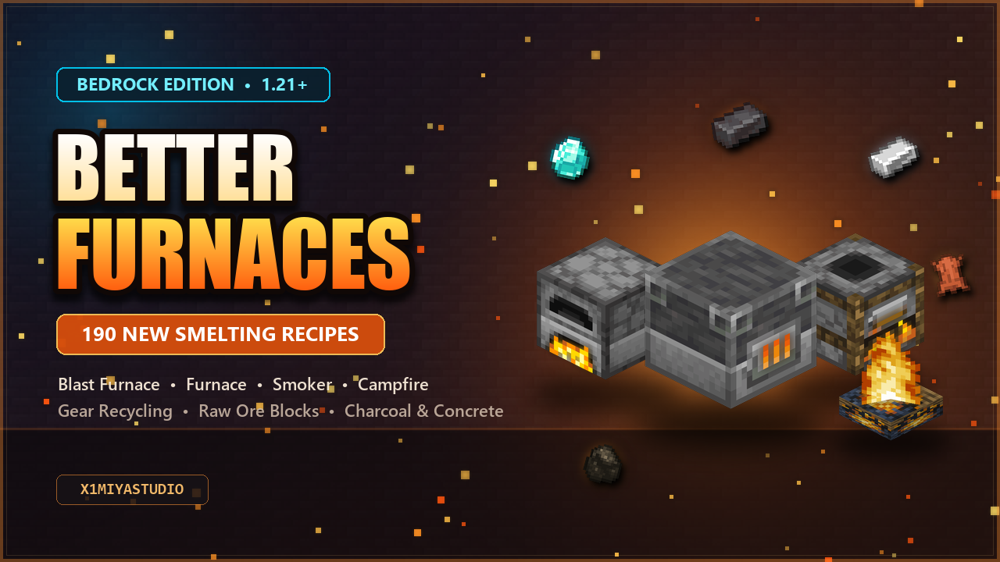

# Better Furnaces — Bedrock Edition

  
  

[-22C55E?style=for-the-badge)](https://github.com/X1miyaStudio/Better-Furnaces-Bedrock/releases)

**Масштабная переработка переплавки для всех ванильных печей и костров в Minecraft Bedrock Edition.**  
Добавляет **190 логичных рецептов переплавки** для **плавильной печи**, **обычной печи**, **коптильни**, **костра** и **костра душ** — без экспериментальных настроек.

---

## ⚙️ Что добавляет аддон (190 рецептов)

### 🔥 1. Плавильная печь (×2 быстрее)
Теперь плавильная печь обрабатывает не только руды, но и высокотемпературные строительные и полезные рецепты:
- **Камень и глубинный сланец:** булыжник ➔ камень ➔ гладкий камень, каменные кирпичи ➔ потрескавшиеся каменные кирпичи, дроблёный глубинный сланец ➔ глубинный сланец, кирпичи/плитка из глубинного сланца ➔ потрескавшиеся варианты.
- **Незер и чернит:** незерак ➔ незерский кирпич, незерские и полированные чернитные кирпичи ➔ потрескавшиеся варианты.
- **Песок, стекло и глина:** песок / красный песок ➔ стекло, песчаник / красный песчаник ➔ гладкие варианты, комок глины ➔ кирпич, глина ➔ терракота.
- **Все 16 видов глазурованной керамики:** любая цветная терракота ➔ глазурованная керамика на скорости ×2.
- **Полезные и декоративные блоки:** базальт ➔ гладкий базальт, кварцевый блок ➔ гладкий кварц, туф ➔ полированный туф, мокрая губка ➔ губка, кактус ➔ зелёный краситель, плод хоруса ➔ жареный плод хоруса.
- **Медь и переплавка древесины в уголь:** сырая медь / медная руда / сланцевая медная руда ➔ медный слиток; все брёвна и древесина Верхнего мира ➔ древесный уголь на скорости ×2.

### ⚒️ 2. Обычная и плавильная печь
Новые рецепты переплавки и переработки работают как в **обычной печи (×1)**, так и в **плавильной печи (×2)**:
- **Блоки сырой руды (массовая переплавка ×9):** блок сырого железа ➔ железный блок, блок сырого золота ➔ золотой блок, блок сырой меди ➔ медный блок.
- **Переработка алмазного и незеритового снаряжения:** алмазные инструменты, броня и конская броня ➔ **алмаз**; незеритовые инструменты и броня ➔ **незеритовый слиток**.
- **Переработка железных, золотых и медных предметов:**
  - Железные инструменты, броня, кольчуга, ножницы, огниво, щит, арбалет, компас, решётки, цепи, фонари ➔ **кусочек железа**
  - Ведро, воронка, вагонетка, котёл, железные дверь и люк ➔ **железный слиток**
  - Наковальня (целая, повреждённая, разбитая) ➔ **железный блок**
  - Золотые инструменты, броня, конская броня, часы ➔ **кусочек золота**; колокол ➔ **золотой слиток**
  - Громоотвод, подзорная труба, медные дверь, люк, решётка и лампа ➔ **медный слиток**
- **16 видов цемента ➔ бетон:** мгновенное термическое затвердевание всех 16 цветов цемента без воды.
- **Незерские стебли, бамбук и мангровые корни ➔ древесный уголь:** багровые и искажённые стебли/гифы, блоки бамбука и корни мангрового дерева.
- **Замшелые и резные каменные блоки:** замшелый булыжник ➔ булыжник, замшелые каменные кирпичи ➔ каменные кирпичи, резные каменные кирпичи / резной глубинный сланец ➔ потрескавшиеся варианты.

### 🍖 3. Коптильня, печь и костры
- **Гнилая плоть ➔ кожа:** переплавляйте `minecraft:rotten_flesh` в `minecraft:leather` в **обычной печи**, **коптильне (×2 быстрее)**, **костре** и **костре душ**!

---

## 📲 Установка

1. Скачайте **`Better-Furnaces-Bedrock.mcpack`** (или `.zip`) со страницы [GitHub Releases](https://github.com/X1miyaStudio/Better-Furnaces-Bedrock/releases) или CurseForge.
2. Откройте файл **`Better-Furnaces-Bedrock.mcpack`** двойным кликом, чтобы автоматически импортировать аддон в **Minecraft Bedrock Edition**.
3. В настройках мира откройте **Behavior Packs (Наборы параметров)** ➔ активируйте **Better Furnaces**.
4. Работает в **Minecraft Bedrock 1.21+** в одиночной игре, Realms и на выделенных серверах (экспериментальные переключатели не требуются).

---

© 2026 **[X1miyaStudio](https://github.com/X1miyaStudio)** · All Rights Reserved

